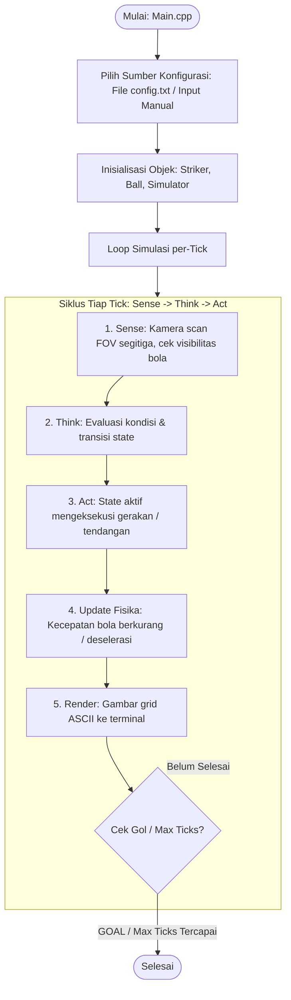
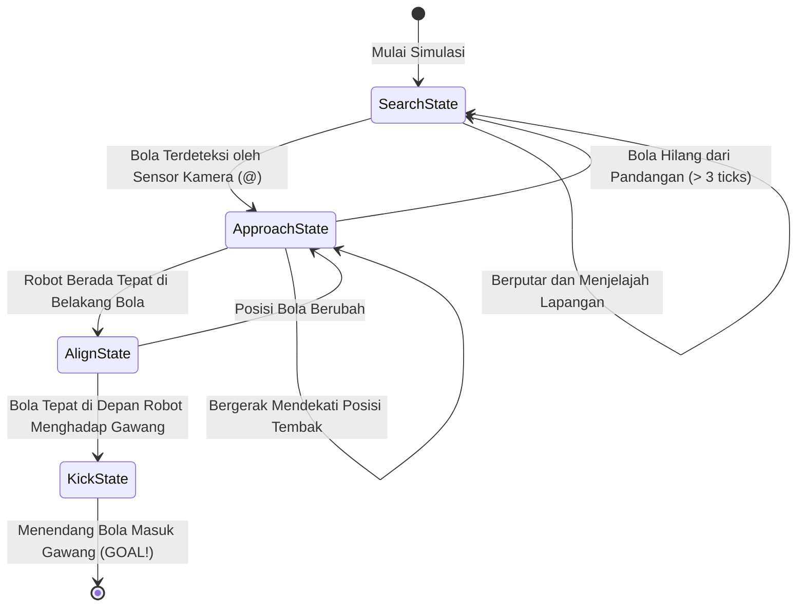
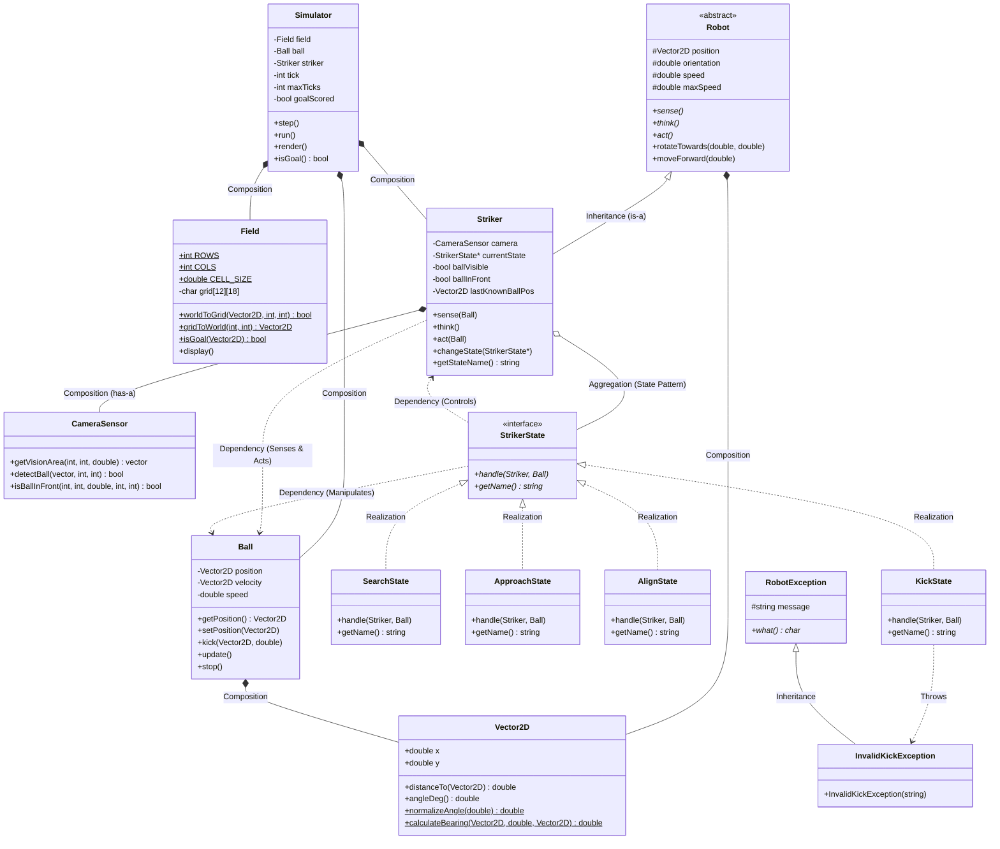

# MAINAN ROBOT - Simulasi AI Striker Robot Soccer (ICHIRO ITS)

Proyek simulasi robot soccer humanoid 2D berbasis terminal untuk robot Striker (Penyerang) otonom. Robot bertugas mencari posisi bola di lapangan, mendekati bola, mengatur sudut tembak, dan menendang bola hingga masuk ke gawang lawan.

---

## Fitur Utama

### Level 1: Core Simulation & OOP
- **Vector2D Helper**: Modul matematika 2D untuk menghitung jarak, bearing angle, dan normalisasi sudut -180° sampai 180° sesuai prinsip DRY.
- **Field ($9\text{m} \times 6\text{m}$)**: Representasi lapangan grid ASCII $18 \times 12$ petak ($1\text{ petak} = 0.5\text{m} \times 0.5\text{m}$) dengan gawang lawan (`#`).
- **Ball**: Objek bola dengan fisika deselerasi nyata ($3 \to 2 \to 1 \to 0\text{ m/tick}$).
- **Abstract Class Robot**: Kelas induk dengan enkapsulasi (getter/setter tervalidasi) dan pembatasan kecepatan maksimum 0.5 m/tick.

### Level 2: Sensor Kamera & Exception Handling
- **Camera Sensor (Vision Segitiga)**: Implementasi sensor kamera (Composition / HAS-A) dengan jangkauan pandang segitiga (tinggi 1.5m, alas 3.5m). Pembacaan bola dilakukan murni melalui sensor kamera tanpa membaca data global simulator.
- **Exception Handling**: Penanganan aksi tidak valid melalui try-catch (misalnya saat robot mencoba menendang bola yang belum berada di posisi depan melalui `InvalidKickException`).

### Level 3: Extra Features
- **Interactive User Input**: Input interaktif koordinat awal robot, sudut hadap, dan posisi bola saat program dijalankan.
- **File Konfigurasi (`config.txt`)**: Penentuan posisi awal Striker dan Bola melalui file teks.
- **State Pattern**: Pengelolaan alur perilaku Striker menggunakan State Pattern (`SearchState` -> `ApproachState` -> `AlignState` -> `KickState`).
- **Arah Tendangan**: Kemampuan eksekusi tendangan lurus maupun miring (diagonal).
- **Unit Testing**: Pengujian independen untuk kalkulasi matematika vektor dan fisika perlambatan bola.

---

## Panduan Kompilasi dan Eksekusi

Pastikan terminal berada di direktori `tugasweek1`.

### 1. Simulasi Utama
```bash
# Kompilasi
g++ -Iinclude src/Ball.cpp src/CameraSensor.cpp src/ConfigLoader.cpp src/Field.cpp src/Main.cpp src/Robot.cpp src/Simulator.cpp src/Striker.cpp src/StrikerState.cpp -o main.exe

# Menjalankan di Git Bash / Linux
./main.exe

# Menjalankan di CMD / PowerShell
main.exe
```

Saat program dijalankan, masukkan koordinat sesuai permintaan di terminal:
```text
Masukkan posisi Robot (x y): -1.5 0.0
Masukkan sudut hadap Robot (derajat): 0.0
Masukkan posisi Bola (x y): 1.0 -0.5
```

### 2. Unit Testing
```bash
g++ -Iinclude src/UnitTest.cpp src/Ball.cpp -o test.exe
./test.exe
```

---

## Arti Simbol Grid

| Simbol | Deskripsi |
|:---:|---|
| `R` | Robot Striker |
| `@` | Area jarak pandang sensor kamera segitiga (Field of View) |
| `O` | Bola |
| `#` | Gawang lawan di sisi kanan ($x = 4.5\text{m}$) |
| `.` | Area kosong lapangan |

---

## Alur Eksekusi Program (Execution Flow)



Simulasi berjalan dalam siklus berbasis **Tick** (*discrete time steps*) dengan alur sebagai berikut:
1. **Inisialisasi**: Pengguna memilih sumber konfigurasi melalui terminal (dari `config.txt` atau input manual koordinat). Objek `Striker`, `Ball`, dan `Simulator` dibuat berdasarkan koordinat tersebut.
2. **Siklus Sense-Think-Act**:
   - **Sense**: Robot menggunakan sensor kamera untuk memindai petak grid di dalam area pandang segitiga (FOV). Menentukan apakah bola terlihat (`ballVisible`) dan apakah bola berada tepat 1 petak di depan robot (`ballInFront`).
   - **Think**: Robot mengevaluasi data sensor dan menentukan apakah perlu berganti state (misal: dari mencari bola ke mendekati bola).
   - **Act**: State yang sedang aktif mengeksekusi aksi nyata (berputar, maju satu petak, bermanuver, atau menendang bola).
3. **Pembaruan Fisika Bola**: Kecepatan bola diperbarui dengan deselerasi bertahap ($3 \to 2 \to 1 \to 0\text{ m/tick}$).
4. **Rendering Terminal**: Layar terminal dibersihkan dan grid ASCII terbaru ditampilkan beserta status robot (posisi, sudut, state, kecepatan bola).
5. **Pengecekan Kondisi Akhir**: Simulasi berhenti jika bola masuk ke gawang lawan ($x \in [4.0, 4.5], y \in [-1.5, 1.5]$) atau batas maksimum tick tercapai.

---

## Alur State AI Striker (State Pattern)



### Penjelasan Detail Perilaku State:
- **`SearchState` (Pencarian Bola)**:
  - Robot berputar sebesar $90^\circ$ setiap tick untuk menyapu pandangan $360^\circ$ di posisinya.
  - Jika setelah putaran penuh bola belum terlihat, robot menjelajahi titik-titik patroli (*waypoints*) yang telah ditentukan di lapangan.
  - Begitu bola masuk ke area FOV segitiga (`@`), state langsung beralih ke `ApproachState`.
- **`ApproachState` (Pendekatan Bola)**:
  - Robot menuju koordinat tepat di belakang bola (target petak tembak).
  - Dilengkapi logika anti-tabrakan: jika robot berada di depan bola pada baris yang sama, robot bermanuver menyamping terlebih dahulu agar tidak mendorong bola ke arah yang salah.
  - Jika bola hilang dari pandangan selama lebih dari 3 tick berturut-turut, robot kembali ke `SearchState`.
  - Saat robot telah tiba di posisi tembak belakang bola, robot menghadapkan diri ke arah gawang lawan ($0^\circ$) dan beralih ke `AlignState`.
- **`AlignState` (Penjajaran Sudut Tembak)**:
  - Memvalidasi bahwa robot berada di posisi baris yang sama dengan bola, menghadap $0^\circ$ (kanan), dan bola berada tepat 1 petak di depannya.
  - Jika kondisi valid terpenuhi, state beralih ke `KickState`. Jika posisi bola bergeser, robot kembali ke `ApproachState`.
- **`KickState` (Eksekusi Tendangan)**:
  - Memverifikasi posisi bola di depan robot (jika tidak di depan, melempar `InvalidKickException`).
  - Menentukan strategi tembakan:
    - **Tendangan Lurus**: Jika posisi bola sejajar horizontal dengan area gawang lawan.
    - **Tendangan Diagonal (Serong)**: Jika bola berada di sisi atas atau bawah lapangan, tendangan diarahkan miring ke tengah gawang.
  - Menghitung kecepatan tendangan yang dibutuhkan agar bola meluncur sampai ke gawang lawan, lalu memicu metode `ball.kick()`.

---

## Garis Besar Algoritma & Lintasan (Path Planning)

### 1. Algoritma yang Digunakan
- **Sense-Think-Act Cycle**: Arsitektur siklus per-tick yang membagi alur kerja robot menjadi pemindaian sensor, evaluasi kondisi, dan eksekusi aksi.
- **Finite State Machine (FSM / State Pattern)**:
  - **Search**: Rotasi $360^\circ$ (putar $90^\circ$/tick) untuk menyapu area pandang, dilanjutkan patroli *waypoints* jika bola belum terlihat.
  - **Approach**: Navigasi berbasis grid menuju posisi tembak di belakang bola ($\text{bCol} - 1$) yang dilengkapi logika manuver menghindar ke samping (*anti-collision*) agar tidak mendorong bola ke belakang.
  - **Align**: Validasi penjajaran sudut hadap lurus menghadap gawang lawan ($0^\circ$).
  - **Kick**: Pengambilan keputusan arah tembak (lurus jika sejajar gawang, diagonal jika berada di sudut/sisi luar) serta perhitungan kecepatan tendangan terukur berdasarkan model deselerasi bola.
- **Vision FOV Triangulation**: Pemetaan area pandang segitiga sensor kamera (jangkauan 3 tingkat, lebar 7 petak) sesuai orientasi robot.

### 2. Lintasan (Path) yang Dipakai
- **Lintasan Patroli / Pencarian**: Rute 7 titik *waypoint* strategis yang disusuri robot secara siklis jika bola belum ditemukan:
  $$(0.0, 1.5) \longrightarrow (2.0, 1.5) \longrightarrow (2.0, -1.5) \longrightarrow (0.0, -1.5) \longrightarrow (-2.5, -1.5) \longrightarrow (-2.5, 1.5) \longrightarrow (-1.0, 0.0)$$
- **Lintasan Pendekatan Bola**: Jalur pendekatan grid bertahap (menyelaraskan baris $Y$ terlebih dahulu, kemudian mendekati kolom $X$) dengan deviasi jalur memutar jika robot berada di sisi depan bola.

---

## Struktur & Alur Relasi Antar-File

Struktur kode diatur secara modular memisahkan antarmuka (*header* `.hpp`) di folder `include/` dan implementasi (*source* `.cpp`) di folder `src/`:

```text
[Main.cpp]
   │
   ├──> [ConfigLoader] (.hpp/.cpp) ──── membaca ────> [config.txt]
   │
   └──> [Simulator] (.hpp/.cpp)
           │
           ├──> [Field] (.hpp/.cpp)  <── Koordinat dunia & Grid ASCII
           ├──> [Ball] (.hpp/.cpp)   <── Objek bola & Deselerasi
           └──> [Striker] (.hpp/.cpp) (Inheritance dari [Robot])
                   │
                   ├──> [CameraSensor] (.hpp/.cpp)  (Komposisi: FOV Segitiga)
                   ├──> [StrikerState] (.hpp/.cpp)  (State Pattern: Search, Approach, Align, Kick)
                   ├──> [Exceptions] (.hpp)         (Error handling: InvalidKickException)
                   └──> [Vector2D] (.hpp)           (Matematika vektor & bearing)
```

---

## Fungsi Masing-Masing File

### 1. Folder Header (`include/`)

| File Header | Fungsi Utama |
|---|---|
| `Vector2D.hpp` | Struktur pembantu matematika vektor 2 dimensi ($x, y$). Mengatur operasi vektor (`+`, `-`, `*`), panjang vektor, normalisasi sudut ($-180^\circ$ s/d $180^\circ$), dan perhitungan sudut relatif (*bearing angle*). |
| `Field.hpp` | Representasi data lapangan ukuran $9\text{m} \times 6\text{m}$ (grid ASCII $12 \times 18$ sel, $1\text{ sel} = 0.5\text{m}$). Mengatur konversi koordinat dunia (meter) ke grid (baris/kolom) serta pendeteksian gawang lawan (`#`). |
| `Ball.hpp` | Representasi objek bola fisik: posisi, arah kecepatan (*velocity*), besaran kecepatan (*speed*), fungsi tendangan (`kick()`), dan penurunan kecepatan bertahap per-tick (`update()`). |
| `CameraSensor.hpp` | Komponen sensor kamera robot (*HAS-A / Composition*). Menghitung petak grid area pandang segitiga (tinggi 1.5m / 3 petak, alas 3.5m / 7 petak) dan mendeteksi keberadaan bola di pandangan atau di depan robot. |
| `Robot.hpp` | *Abstract Base Class* (kelas induk) robot. Menyimpan atribut posisi, orientasi/sudut hadap, kecepatan (dibatasi maks 0.5 m/tick), dan metode antarmuka virtual murni `sense()`, `think()`, dan `act()`. |
| `Striker.hpp` | Kelas turunan dari `Robot` (*IS-A / Inheritance*). Mengintegrasikan sensor kamera, menyimpan referensi `StrikerState` saat ini, mencatat posisi terakhir bola yang terlihat, dan menjalankan siklus *Sense-Think-Act*. |
| `StrikerState.hpp` | Antarmuka (*Interface*) `StrikerState` dan deklarasi kelas konkret State Pattern: `SearchState`, `ApproachState`, `AlignState`, dan `KickState`. |
| `Exceptions.hpp` | Hierarki kelas eksepsi kustom (`RobotException`, `InvalidKickException`, `OutOfBoundsException`) untuk menangani aksi tidak valid saat runtime. |
| `ConfigLoader.hpp` | Definisi struktur data konfigurasi `SimConfig` dan deklarasi fungsi pemuat konfigurasi dari file teks. |
| `Simulator.hpp` | Deklarasi kelas simulator utama yang mengorkestrasi lapangan, bola, robot striker, dan perulangan tick simulasi. |

### 2. Folder Source (`src/`)

| File Source | Implementasi & Tanggung Jawab |
|---|---|
| `Main.cpp` | Titik awal (*entry point*) program. Menangani interaksi pengguna di terminal (pemilihan sumber konfigurasi), membuat objek `Striker`, `Ball`, dan `Simulator`, lalu menjalankan simulasi. |
| `Simulator.cpp` | Mengatur alur loop simulasi (`step()` dan `run()`): memicu urutan `sense -> think -> act -> update fisika bola`, merender tampilan terminal dengan kode warna ASCII/ANSI kursor, serta mengecek kondisi gol. |
| `Striker.cpp` | Mengimplementasikan logika sensor robot, pergantian state (*Rule of Three* untuk deep copy pointer state), serta delegasi eksekusi aksi ke state aktif. |
| `StrikerState.cpp` | Mengimplementasikan logika tingkah laku AI pada tiap state: pemindaian sudut dan patroli lapangan (`SearchState`), navigasi manuver menghindar dan mengejar posisi tembak (`ApproachState`), pengecekan kelurusan sudut (`AlignState`), dan penentuan arah tembakan lurus/diagonal serta daya tendang (`KickState`). |
| `CameraSensor.cpp` | Mengimplementasikan perhitungan matematis transformasi matriks koordinat FOV segitiga berdasarkan sudut hadap robot ($0^\circ, 90^\circ, 180^\circ, 270^\circ$). |
| `Ball.cpp` | Mengimplementasikan gerak bola di lapangan dan penurunan kecepatan linier secara bertahap ($3 \to 2 \to 1 \to 0\text{ m/tick}$). |
| `Robot.cpp` | Mengimplementasikan pergerakan translasi maju robot (`moveForward`) dan rotasi sudut bertahap (`rotateTowards`) dengan batas kecepatan maksimal. |
| `Field.cpp` | Mengimplementasikan pencetakan grid ASCII ke konsol terminal, manipulasi karakter sel grid, dan pemetaan koordinat dunia ke sel array. |
| `ConfigLoader.cpp` | Menguraikan (*parsing*) file teks baris per baris dengan format `key=value` untuk memuat koordinat robot, arah hadap, koordinat bola, dan batas tick. |
| `UnitTest.cpp` | Pengujian unit independen menggunakan `assert` untuk memvalidasi akurasi fungsi matematika `Vector2D` dan perilaku fisika perlambatan `Ball`. |

### 3. File Konfigurasi & Build

| File | Deskripsi |
|---|---|
| `config.txt` | File konfigurasi teks default berisi parameter posisi awal robot, sudut hadap, posisi bola, dan jumlah maksimal tick simulasi. |
| `CMakeLists.txt` | Konfigurasi sistem build CMake untuk mengompilasi program simulasi utama (`main`) dan program unit test (`unittest`). |

---

## Diagram Kelas (Arsitektur OOP)



---

## Pernyataan Penggunaan AI

AI digunakan sebagai asisten pemrograman untuk membantu:
- Penataan struktur modular C++ dan header `.hpp`.
- Perhitungan geometris area vision kamera segitiga.
- Pembuatan visualisasi diagram Mermaid pada dokumentasi.
Seluruh logika inti algoritma, validasi OOP, enkapsulasi, dan eksekusi program telah diverifikasi dan diuji sesuai spesifikasi tugas.
